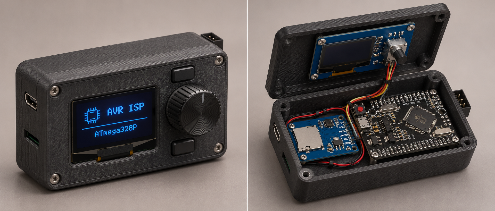

# AVR ISP SD Programmer

Eigenständiger 5-V-Programmer für ATmega328 und ATmega328P. Ein Mega 2560 Pro
liest Intel-HEX und Fuse-Profile von microSD. Über das OLED und den Encoder
wählst du das Profil, mit CONFIRM programmierst du das Ziel.



Das Bild zeigt den Designentwurf. Das parametrische [OpenSCAD-Modell](case/gehaeuse.scad)
verwendet vorläufige Maße. Die Firmware ist ein Prototyp, der noch an der
konkreten Hardware erprobt werden muss.

## Inbetriebnahme

1. Baue die Schaltung nach der [Verdrahtung](docs/verdrahtung.md) auf.
2. Installiere [PlatformIO](https://platformio.org/install/cli). Baue mit
   `pio run` und lade mit `pio run -t upload` über USB auf den Mega 2560 Pro.
3. Formatiere eine microSD-Karte mit FAT16 oder FAT32. Kopiere HEX und CFG ins
   Stammverzeichnis und starte den Programmer nach dem Einsetzen der Karte neu.
4. Verbinde ein separat versorgtes 5-V-Ziel mit ISP. Drehe zur Profilauswahl,
   nutze den Encoder-Druck zur Detailanzeige und drücke CONFIRM zum Start.
   BACK zeigt wieder die Profilauswahl.
5. Warte auf `OK - verifiziert`, bevor du das Ziel abziehst.

## Profile

Bis zu 32 Profile werden über ihre 8.3-Dateinamen angezeigt. Eine CFG besteht
aus genau einer ASCII-Zeile. Das mitgelieferte Beispiel dient als Formatvorlage.

```text
IMAGE.HEX 0F E2 D9 FF
```

Die Felder sind HEX-Datei, letztes Signaturbyte, Low-, High- und Extended-Fuse.
`0F` steht für ATmega328P und `14` für ATmega328. Das Beispiel setzt internen
8-MHz-Takt und startet bei Flash-Adresse 0. Es passt nur, wenn der Firmware-Build
und die Zielhardware dazu passen. Der Chip-Erase löscht den bisherigen Flash
einschließlich Bootloader. Soll ein Bootloader installiert werden, muss er Teil
der HEX-Datei sein und zum Resetvektor und zur Bootbereichsgröße passen.

Der Programmer prüft die vollständige HEX-Datei vor dem Löschen. Er erwartet
aufsteigende, überlappungsfreie Intel-HEX-Daten im Bereich 0 bis 32767,
einen EOF-Datensatz und optional vorangestellte Adresserweiterungen mit Basis
null. Unbelegte Flash-Bereiche werden beim Rücklesen als gelöscht geprüft.
Die Firmware lehnt Profile mit RSTDISBL, DWEN oder deaktiviertem SPIEN ab.
Der Status OK bestätigt die Rückleseprüfung. Der Start der Anwendung nach
dem Verlassen des Programmiermodus ist separat zu prüfen.

**EEPROM:** Bei gesetztem EESAVE im vorhandenen High-Fuse bleibt das EEPROM
beim Chip-Erase erhalten. Erwartet das Profil Erhalt, bricht die Firmware ab,
wenn EESAVE am Ziel noch nicht gesetzt ist. EEPROM-Dateien und Lock-Bits sind
in dieser Version nicht implementiert.

## Gehäuse

Der Entwurf ist ein zweiteiliges Gehäuse mit ungefähr 112 × 75 × 32 mm ohne
Encoderknopf. Das OLED sitzt hinter dem Deckel, Mega und microSD auf dem
Boden. USB und SD sind von links erreichbar, ISP sitzt rechts. Deckel und
Boden sind separat druckbar. Details und Aufmaß stehen im [Gehäuseplan](case/README.md).

## Veröffentlichung

Der Ordner kann als neues GitHub-Repository übernommen werden. Der Workflow
baut die Firmware bei Pushes und Pull Requests. Wähle vor Veröffentlichung
eine Lizenz für Code, CAD und Dokumentation. Der Paketstand enthält keine
Ziel-Firmware und kein Foto deiner Module.
